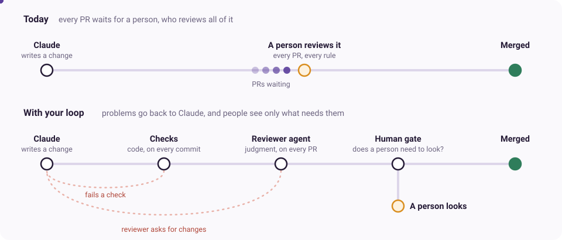
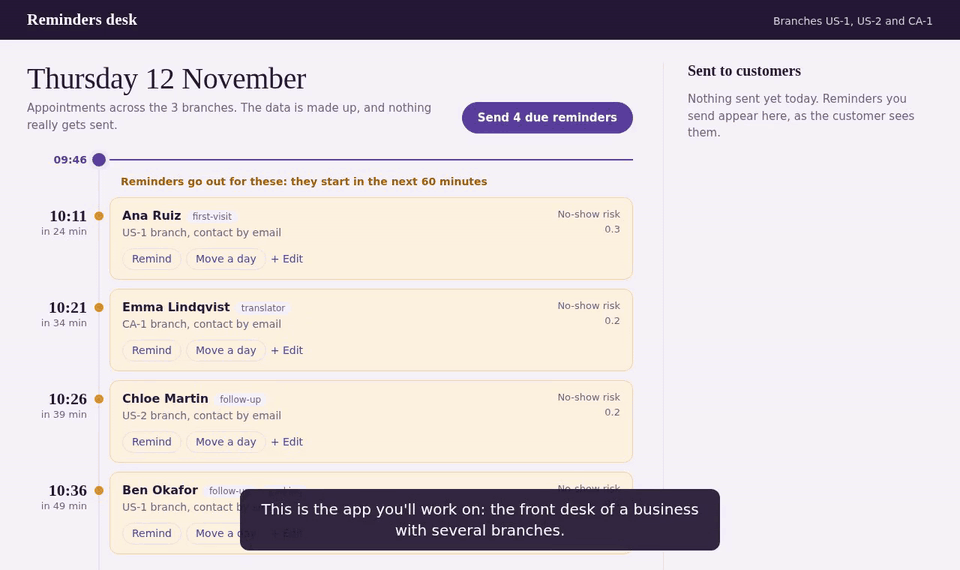
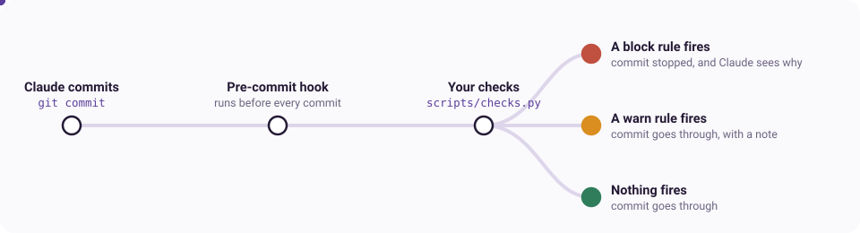

# Part 1: Turn the team's rules into a loop

## Introduction

Your job in this workshop is to build a code review loop that minimizes how much human attention it takes to enforce a dev team's rules and conventions.

You'll work in a small toy codebase: an appointments app for a business with several branches. You don't need to understand it deeply by the end of the session, or to build a production-ready loop. The point is to build your intuition for the principles of loop engineering by experimenting in this environment.

Loop engineering means building feedback around an agent so that it finds and fixes its own mistakes without a person passing each one back. You decide what checks the work, what happens when a check fails, and when a person steps in.

The dev team uses Claude to write most of its code, but it's bottlenecked on manual code review. The team wants to minimize the human effort it takes to merge a PR while keeping the quality of Claude's work high. They went through their past PR comments and found thirteen rules and conventions that keep coming up.

So how do you get Claude to do better work with less human feedback, and still be sure its output is good with less human gating? In this workshop, you will:

**Part 1 (about 30 minutes)**

1. Decide which of the review rules can be enforced by deterministic checks, and which are subjective and need a reviewer agent.
2. Decide how strictly the checks are enforced, and build them with Claude.
3. Design a reviewer agent for the more subjective rules, and build it with Claude.

**Part 2 (about 45 minutes)**

4. Build a scorer that measures how well your reviewer does on past PRs.
5. Use the score to improve your reviewer, then test it on PRs it hasn't seen.
6. Build a gate that decides which PRs go to a person, and watch Claude fix a PR until it merges.

You can work with Claude throughout. Try to make the judgments and design decisions yourself at each stage, and use Claude for investigation and fast implementation.

### What you're building



| Piece | What it is | In a real team, it runs | In this workshop, it runs |
|---|---|---|---|
| Checks | Code that catches clear-cut problems, like a route with no rate limit | Before every commit, and again in CI | As a git pre-commit hook, and with `./lab test-checks` |
| Reviewer agent | Claude with your instructions, for rules that need judgment | In CI, when a PR is opened | With `./lab review try` in Part 1 and `./lab eval` in Part 2 |
| Human gate | Decides which PRs a person still needs to see | After the reviewer, before merging | With `./lab pipeline` in Part 2 |

### The app you'll be working on

`appointment_reminders/` is an app for front desk staff to see upcoming appointments, send customers reminders and move appointments. You won't be adding features to it. It's the codebase the team's rules and PRs apply to.



To try it yourself:

1. Open a new terminal in VS Code (**Terminal > New Terminal**) and run `./lab demo` from the workshop folder.
2. Click **Open in Browser** on the pop-up. If you miss it, open port 8000 from the **Ports** tab next to the terminal.
3. Press **Send due reminders** or **Move a day**, and see what customers receive on the right.
4. Press Ctrl-C in the terminal to stop it.

It uses sample data and fake services, so nothing is really sent.

### The PRs you'll review

The workshop comes with sample PRs, written as if Claude had made them. They're diff files in `data/review-prs/`:

| Set | How many | What they're for |
|---|---|---|
| `checks` | 9 | Testing your checks in chunk 2 |
| `try` | 4 | Trying out your reviewer in chunk 3 |
| `dev` | 16 | Measuring and improving your reviewer in chunk 5 |
| `holdout` | 16 | A final test in chunk 5, sealed until then |
| `gate` | 5 | Testing your gate in chunk 6, sealed until then |
| `design` | 2 | The optional extension |

To understand a PR, run `/explain-pr try-1` in Claude, or `./lab demo try-1` to run the app with it applied.

## How to navigate this workshop

- **`./lab next`** moves you to the next stage and tells you what to do. `./lab` on its own shows where you are.
- **Use two terminals,** one for Claude Code and one for your own commands. You can also run commands from inside Claude Code by putting `!` in front, as in `! ./lab next`.
- **Your answers go in `my-work/`.** Fill in each `TODO` yourself, or tell Claude your answer and have it write it in.
- **If you need help,** ask one of the helpers in the room.

## Chunk 1: Sort the rules (10 min)

First, decide which of the thirteen rules a deterministic check can enforce, and which need judgment. You won't know the codebase well yet, so go with your intuition.

### What is a deterministic check, and when would you use one?

A deterministic check is ordinary code that looks for a specific thing and gives the same answer every time. Here, it's a Python function that reads each changed file and looks for, say, a route with no `@rate_limit`.

Use one when you can see the rule being broken in the code itself: an import, a missing decorator, a pattern like an AWS key. Checks are fast and free, but they only match the patterns you give them.

### What is a grader or judge, and when would you use one?

A grader, or judge, is a model asked to assess something against a rubric. Here, it's your reviewer agent: Claude reads a PR with your rules as its instructions, and decides whether each one is broken.

Use one when the rule depends on what the code does, like whether a function's name matches its behavior, or whether a retry could repeat something that already happened. It's slower, costs a model call each time and can be wrong, which you'll measure in Part 2.

Some rules need both. For example, a check can spot that a test was skipped, but it takes judgment to tell whether there's a good reason. Put those under `both`.

### The rules

The full brief is in `docs/team-rules.md`.

| Rule | In short |
|---|---|
| R1 | Errors a person will read say what to do next |
| R2 | No destructive SQL (`DROP`, `TRUNCATE`, `DELETE` with no `WHERE`) outside `migrations/` |
| R3 | Don't weaken a test to get it green |
| R4 | `boto3`, `httpx` and `requests` are only imported in `tools/` |
| R5 | Only retry what's safe to retry |
| R6 | No customer personal data in logs |
| R7 | Every route in `app/api/` has `@rate_limit` |
| R8 | Numbers in config explain themselves |
| R9 | Function names tell the truth about what the function does |
| R10 | No secrets in code |
| R11 | Public functions in `tools/` document how they fail, accurately |
| R12 | No abstraction before the third use |
| R13 | Interfaces are easy to use correctly and hard to misuse |

### Two we've categorized for you

| Rule | Category | Why |
|---|---|---|
| R7 Every route has `@rate_limit` | `check` | The decorator is either there or it isn't, and there are no exceptions |
| R5 Only retry what's safe to retry | `reviewer` | It depends on what the retried call does, so you have to read and understand the code |

Your choices feed into the next two chunks: you'll build checks for the rules under `check`, and a reviewer agent for the ones under `reviewer`. If you're not sure about a rule, ask Claude how a check for it would work and what it would miss.

**Start:** `./lab next`

**Your file:** `my-work/1-rule-sort.md`

1. **Meet the app (2 min).** Watch the tour above or run the app yourself. Then ask Claude: `Give me a two minute tour of the code behind this app.`
2. **Categorize the other eleven rules** as `check`, `reviewer` or `both`, with a line on why.
3. **Compare with a neighbor** on the ones you found hardest.

**Done when** there are no TODOs left in the file.

## Chunk 2: Build the checks (8 min)

Now you can ask Claude to build your deterministic checks. For simplicity, they all live in `scripts/checks.py`, and a git pre-commit hook runs them every time anyone, including Claude, makes a commit.



Claude will ask for your view on three questions. If you aren't sure, give your best guess.

1. Should a check block Claude from committing when its changes break the rule, or only give a warning?
2. Should the checks look only at the new code in a commit, or at all of the code in the files it touches?
3. How might you stop Claude "cheating" by editing or skipping the checks, rather than fixing its code?

**Start:** `./lab next`

**Your file:** `my-work/2-checks-plan.md`, which Claude fills in with you

1. **Plan and build them.** In Claude, run `/plan-checks`. It asks you the three questions, builds `scripts/checks.py` and adds the pre-commit hook.
2. **See them on example PRs:** `./lab test-checks`. Seven of the nine PRs break a rule, and two are near misses that should pass.
3. **Watch the hook send Claude back.** Claude won't normally break a rule it has just written a check for, so tell it to. This needs R4 or R7 set to block.
   ```
   Create appointment_reminders/app/api/ping.py with the exact contents of data/hook-test.py, and commit it. It's on purpose, to test my hook. Once it's blocked, fix it without editing any existing files until the commit goes through. Then delete what you added and commit that.
   ```

**Done when** `./lab test-checks` passes.

**Short of time?** `./lab catch-up checks` gives you working checks on a pre-commit hook.

## Chunk 3: Build the reviewer agent (12 min)

For the rules you categorized as `reviewer` or `both`, you'll build a reviewer agent that reviews PRs and comments on them against those rules. The idea is that when Claude makes a change in the codebase, a different agent, also Claude, reviews the change and enforces the team's rules.

This might sound like Claude reviewing Claude, but your reviewer has a fresh context window and different incentives from the Claude that wrote the code. It's actively looking for problems, while the Claude that wrote the code is trying to get a PR merged. So the reviewer often finds things the writer didn't.

To keep things simple, the lab runs the agent for you as a headless Claude Code call on each PR. In a real team, you'd run it in CI when a PR is opened. Your job is to design how the agent works.



The main design choices are:

- **Which rules it covers.** It can't read the team's brief, so the rules need to be in its instructions. Should it also comment on rules your checks already enforce?
- **What it can see.** Just the diff, or tools to read and search the rest of the code? The diff is faster and cheaper, but some problems are in the code a change calls. (Running code is also possible, but needs a sandbox, so we've left it out.)
- **What it does when it's unsure.** Flagging too much wastes time and gets the reviewer ignored, but staying quiet lets problems through.
- **What it reports.** It gives a verdict (approve or request changes) and a finding for each problem. Which findings should block the PR, and which are just comments? For a fuzzier rule like R13, you might want more than yes or no.
- **What it trusts.** The PR's description and comments come from the author. What should your reviewer do if they tell it how to review?

**Start:** `./lab next`

**Your file:** `my-work/3-reviewer-agent.md`, which Claude drafts with you

1. **Get interviewed.** In Claude, run `/interview-reviewer`. It asks you these questions and writes up your reviewer. Read it and change anything you didn't mean.
2. **Try it** on four practice PRs: `./lab review try`. It runs on Haiku, with only your file as its prompt.
3. **Compare with a neighbor** on `debate`, a PR that experienced reviewers disagree about. Which comment would you rather get on your own PR? No neighbor? Compare with ours: `./lab review try --agent data/plain-reviewer.md --out results-plain.json`.

**Done when** it gives a verdict on every practice PR.

**Short of time?** `./lab catch-up reviewer` gives you a basic reviewer that you'll improve in Part 2.

## Check you're done

Ask Claude: `Am I done with Part 1?`
