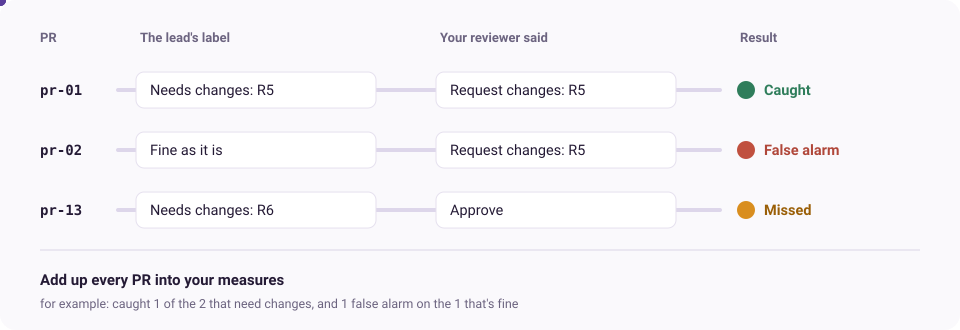
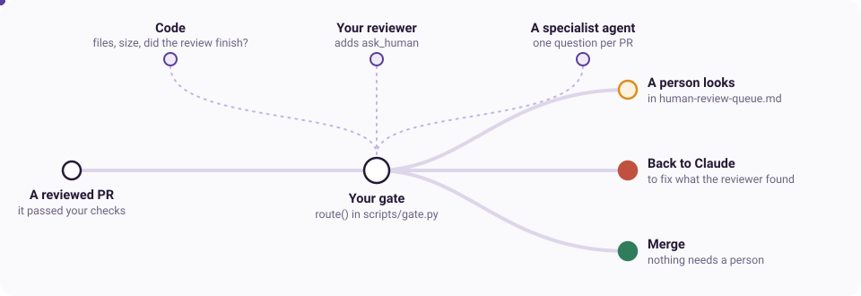

# Part 2: Can you trust your reviewer?

## Introduction

In Part 1 you built two kinds of review. Your deterministic checks are easy to trust: you tested them on known cases, and they give the same answer every time. Your reviewer agent is different. It makes judgments, and its answers can change from one run to the next. Its answers on the practice PRs looked sensible, but how do you check that it's making good judgments?

In Part 1 you met the idea of a judge: a model that assesses something against a rubric. Your reviewer is the judge in your loop. Now you need a way to check the judge. You do that with an eval: run the reviewer on PRs where a good answer is already known, and score how close it gets. On a real codebase, an obvious source of good answers is past reviews by experienced developers. Another is past PRs that turned out to be risky and that a person *didn't* catch: changes that slipped through and led to a real incident or rollback.

In Part 2, you will:

4. **Design how to score your reviewer.** For today, we're providing some past PRs with good answers. Based on them, you'll think about how to score your reviewer against them.
5. **Build the scorer, and improve your reviewer.** Based on your design, Claude builds the scorer, and you test your reviewer against it. Seeing where your reviewer does badly helps you improve it. At the end, you test it on a held-out set of PRs with good answers that the reviewer hasn't seen before. That checks that you haven't improved it only on the narrow set of PRs you've been testing it against.
6. **Decide what happens next.** Once a PR Claude wrote has passed your deterministic checks *and* your reviewer, you need to decide what to do with it: let it merge, or send it to a person for review. You'll build a gate that decides which PRs go to a person.

**Part 2 is about 45 minutes, in three chunks of 15.** It carries straight on from Part 1, with the agent you built there.

### How an eval works

An eval needs two things for each PR: a good answer, and your reviewer's answer. Comparing them gives a result for that PR, and adding up the results gives your measures:



**A gold label is a good answer for one PR,** decided by a person before the agent runs. Here, the team lead has reviewed sixteen past PRs. Each label says whether the PR needs changes, which rule it breaks, and why. Here are three examples:

| PR | Needs changes? | Rule | The lead's reason |
|---|---|---|---|
| pr-01 | yes | R5 | `set_appointment_time` also emails the customer, so a retry can email twice. The PR says it's idempotent |
| pr-02 | no | | Twin of pr-01, same wording: `set_contact_preference` is a plain PUT |
| pr-13 | yes | R6 | `Reminder` is a dataclass, so `%s` prints `customer_email` |

pr-01 and pr-02 look almost the same, and only one of them is a problem. The difference is in the code each one calls, which the diff doesn't show. A reviewer that flags both, or neither, is guessing.

**Scoring compares the label and the answer for each PR,** and puts it in one of these:

| | Your reviewer asked for changes | Your reviewer approved |
|---|---|---|
| **The label says it needs changes** | Caught, if it named the right rule. If it named a different rule, it had the right verdict for the wrong reason | Missed |
| **The label says it's fine** | False alarm | Correctly approved |

Then you choose measures that say what you care about, such as how many of the eight problem PRs it caught, and how many false alarms it raised on the eight clean ones. You'll decide what yours are in chunk 4.

**One number isn't enough.** Half the sixteen PRs are clean, so a reviewer that approves everything agrees with the labels half the time, and so does one that flags everything. The lab comes with both, as canned answers, and here's how our scorer sees them:

| Canned reviewer | Caught | False alarms |
|---|---|---|
| Approves every PR | 0 of 8 | 0 of 8 |
| Flags every PR, on every rule | 8 of 8 | 8 of 8 |

Each looks perfect on one measure and useless on the other. A good reviewer has to do well on both.

**Two sets of PRs, for two jobs.** You improve your reviewer on the sixteen dev PRs, the ones with the lead's labels, looking at what it gets wrong each time. That makes it better at those sixteen, but maybe only those: it can learn the PRs rather than the rules. So eight more PRs, the held-out set, stay sealed until the end, and you run your reviewer on them once, as a fair test.

## Chunk 4: Design the eval (15 min)

Now you need to decide how to score your reviewer against the lead's good answers. You don't need to read all sixteen: they're in `data/review-prs/lead-labels.csv` if you want them, and Claude can walk you through any of them. For simplicity, Claude will build the scorer for you in chunk 5. Your job here is to design it.

Here are the decisions you need to make, and why they matter. Claude will ask you for your view on each. It's fine if you aren't sure: give your best guess, based on your intuition about what a good reviewer does.

- **What makes a review good?** Think about what a good reviewer does before you think about metrics. Catching problems is one part, and staying quiet on clean work is another.
- **What counts as right on one PR?** If the lead says a PR breaks R5, and your reviewer asks for changes because of R9, did it catch the problem? It got the verdict right, but a developer would go and fix the wrong thing.
- **What could make your score lie?** Sixteen PRs is few, and your reviewer's answers vary from run to run. If you keep tuning it to these sixteen, it can get better at them without getting better at reviewing.
- **How good is good enough, and for which job?** Leaving a comment, blocking a merge and approving with no person are different jobs. A miss and a false alarm cost the team different things, so each job can need a different bar.

**Start:** `./lab next`. It opens the lead's labels.

1. **If it would help, look at a couple of PRs.** Ask Claude to walk you through one and its label, such as `/explain-pr pr-01` and then `/explain-pr pr-02`, the two that look alike. `./lab demo pr-01` runs the app with a PR applied. If you think a label is wrong, you can change it in the file.
2. **Design the eval.** In Claude, run `/design-eval`. It asks you the four questions above, and writes your answers into `my-work/4-eval-design.md`.

**Done when** there are no TODOs left in `my-work/4-eval-design.md`.

## Chunk 5: Build the eval and improve the agent (15 min)

Now Claude can build the scorer from your design, and you can use it to improve your reviewer. For simplicity, one command runs your reviewer on the sixteen dev PRs and scores it: `./lab eval`. Each score is added to `my-work/notes.md`, so you can see what each change did. You can run it yourself, or ask Claude to run it for you. Your job is to decide what to change, and to make sure the improvements are real.

Improving an agent against an eval is a loop: run it, score it, read what it got wrong, change it, and run it again. Here are the choices worth thinking about, and why they matter:

- **What to change.** You can change the agent's instructions, but also what it can see. For example, some PRs can't be judged correctly from the diff alone, like pr-01 and pr-02. Adding tools such as `Read`, `Grep` and `Glob` lets your reviewer search the wider codebase for context, and could improve its performance. The `tools:` line in your agent decides: blank means only the PR.
- **Signal or noise?** Your reviewer's answers vary between runs, so one better score can be luck. Running it twice tells you whether a change really helped.
- **A fix, or a cheat sheet?** Claude will suggest changes to your agent. A line that names a specific PR makes the score better without making the reviewer better, so read every change.
- **Is the label wrong?** Sometimes the reviewer has a point, and the lead's answer is the one to change.

At the end, you run your reviewer once on the eight held-out PRs, which it has never seen. That's the fair test of whether it learned the rules, or just these sixteen PRs.

**Start:** `./lab next`

1. **Build the scorer with Claude.** Ask Claude: `Help me build my eval scorer.` It builds it from your design in `my-work/4-eval-design.md`, then tries it on the two canned reviewers, one that approves everything and one that flags everything, to show you that neither looks good.
2. **Get your baseline:** `./lab eval`. It takes about a minute. A perfect score first time is a reason to check your scorer.
3. **Improve the agent.** Ask Claude to read the misses and false alarms, change the agent, and run `./lab eval` again. Keep the four choices above in mind.
4. **The fair test (last 3 min):** `./lab holdout`. It freezes a copy of your agent, opens the eight held-out PRs, and runs and scores the frozen copy on them. The copy stays fixed, since changing the agent after seeing these PRs would spoil the test. Eight PRs are too few for a percentage, so read each error rather than the number.

**Done when** you can name the change that moved your score most, and you've read any held-out errors.

**Short of time?** `./lab catch-up eval` gives you a scorer. Spend the time on the agent.

## Chunk 6: Add a human gate (15 min)

Once a PR Claude wrote has passed your checks and been through your reviewer, you need to decide what happens to it. Even a good reviewer shouldn't have the last word on every PR. Some changes the team wants a person to see whatever the reviewer says, like anything touching customer records. And some are cases where the reviewer itself can't be trusted, such as a PR whose description tries to steer it.

So you'll add a gate. It runs after the reviewer, and sends each PR one of three ways: to a person, back to Claude to fix what the reviewer found, or on to merge. For simplicity, Claude will build the gate for you. Your job is to decide how it spots the PRs that need a person.



### The lead's preferences

The team lead has said which PRs a person should see before they merge, whatever the reviewer says. They're in `docs/human-review.md`, and here in short:

| | A person should see |
|---|---|
| H1 | Anything that touches customer records or personal data: `service/records.py` and `service/models.py` |
| H2 | Anything over 50 added lines. Big PRs are where things hide |
| H3 | Anything whose checks didn't finish: a review that failed, timed out or gave no verdict |
| H4 | Anything the reviewer wasn't sure about |
| H5 | A PR whose description, comments or code try to steer whoever reviews it |
| H6 | Changes to how we retry, queue or send messages, where a mistake reaches customers |

H1 to H3 are already decided: they're about what's in the PR, so the gate's code checks them. H4 to H6 are yours.

### Your options

For each of the lead's preferences, think about how you might identify the PRs it describes and trigger the escalation to a person. Again, we aren't looking for a perfect understanding of the codebase, just your intuition about which of these triggers might work, and how each could fail:

- **Code in the gate.** Simple rules about what's in the PR. For example, changes to certain files always go to a person, or any PR over a certain size does, or any PR whose text contains certain phrases. It's certain and cheap, but it can't tell what a change means.
- **Your reviewer.** You can tell it to ask for a person, by calling `alert_human`, when it isn't sure or when a finding is serious. It's the only one that knows its own doubts, but it's also the thing being judged, so it can't protect you from its own mistakes, or from a PR that has steered it.
- **A specialist agent.** A separate agent that checks every PR against criteria you give it. For example, you could ask it whether a change is high risk, because it changes how messages are retried, queued or sent. It can judge what a change does, not just which files it touches, but it costs a model call on every PR, and it can be wrong too.

**Start:** `./lab next`

1. **Make your choices** for H4 to H6. Write them in `my-work/5-human-gate.md`, or tell Claude and have it write them in.
2. **Build it.** Ask Claude: `Build my human gate.` It builds the gate's rules in `scripts/gate.py`, tells your reviewer when to call `alert_human`, and writes your specialist agent in `my-work/6-gate-agent.md` if you chose one. Then it runs `./lab test-gate`, which tries your gate on tricky situations, such as a reviewer that crashes. Nobody is really alerted.
3. **Run the whole system:** `./lab pipeline`. It runs your checks, then your reviewer, then your gate, on the sixteen dev PRs, and anything sent to a person lands in `human-review-queue.md`. Does what's there match the lead's preferences? And is the number right?

**Done when** `./lab test-gate` passes and you've read the queue.

**Short of time?** `./lab catch-up gate` gives you a gate and a specialist agent that pass. Read them, and argue with one of the choices.

## Check you're done

Ask Claude: `Am I done with Part 2?`

## Extension: does a stronger model review better? (optional, about 15 min)

**Your file:** `my-work/extension-models.md`

Your reviewer has been running on Haiku. Answer the questions in your file, then ask Claude to help you run and compare the models, with the same agent on the same PRs. Any model runs like this:

```bash
LAB_REVIEW_MODEL=sonnet ./lab review dev --out results-sonnet.json
./lab score --results results-sonnet.json
LAB_REVIEW_MODEL=opus ./lab review design --out results-design-opus.json
```

**Things you could look at:**

- What it catches, and its false alarms
- How much its answers change between runs
- How it handles R13, on the design PRs
- Whether you'd want its comments on your own PR
- What it costs and how long it takes: each review prints a cost estimate

